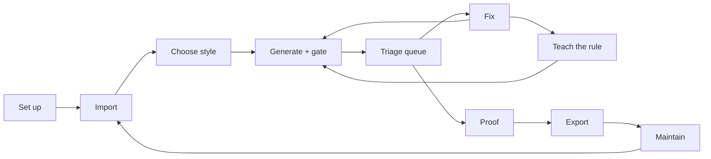

# Variance app: end-to-end flows

_Design doc · 2026-11-28 · Draft for Sean's review. Live version with
wireframes: [app-flows.html](app-flows.html). Builds on the research thread's
brief, [manual-fix-tooling.md](manual-fix-tooling.md), and research 01–08._

## Answer

- **Variance is a design-token system for icon geometry.** A set's house style
  (the rule) is the global tier. Edge contexts ("counter edge at wght 700")
  are the semantic tier. Per-part and per-segment settings are the component
  tier. A manual fix is a component-level override that the rule never
  overwrites. Every value in the inspector shows which tier it resolved from.
- **The app is one loop with six stages:** import, choose a style, generate,
  triage, fix, export. A seventh stage, "teach the rule", feeds fixes back so
  the next icons need fewer of them. After the first release, most time is
  spent in a maintenance flow: add an icon, re-import a changed one, ship.
- **Designers should spend their time in the review queue, not the grid.** The
  generator reaches 76%/64% of Google's edges on its own and 94%/89% with
  fitted settings. The queue ranks icons by risk and says why each one is
  there, so a designer checks the worst 10–20% instead of all of them.
- **Fit to a drawing is the headline tool.** Draw one master by hand once;
  Variance turns it into settings on the source. Side pins and end handles
  cover the fixes that don't need a drawing.
- **Three things can't reach 100% by rule:** anchor choices the rule gets
  wrong, stroke end and junction shapes, and real redraws (mostly small
  sizes). Each has a tool below. Real redraws at small sizes need one new
  capability: collapsing a part to nothing below a size, or swapping in an
  alternate construction. That is open decision 5.
- **Decided 2026-11-28:** a local web app over the Python core; Variance owns
  the source after import, saved locally as plain SVG and JSON; collapse-only
  for small sizes in v1; outline import in v1. Five smaller decisions remain.

## Who it's for

| Person | Job | What "done" means to them |
|---|---|---|
| **Set designer** (primary) | Turn a set they drew, or inherited, into a variable font | Every icon passes the gates; the worst icons got a human look; the font ships |
| **Set maintainer** | Add and change icons after release | A new icon lands in the next build without re-checking the whole set |
| **Consumer** (engineer or product designer) | Use the font in product | Stable code points and names, a changelog, the same file for the same source |

The set designer is the person this doc designs for. The other two shape the
maintenance and export flows.

## The object model (information architecture)

Everything in the app is one of these objects. Names are user-facing.

| Object | What it is | Holds |
|---|---|---|
| **Set** | One icon family that becomes one font | Grid (960 units, 24 px), axes and ranges, naming and code point scheme, the style, the build history |
| **Style** | The set's house rule for how edges move | A preset (Pen, Anchored) or a rule learned from a second style or from fixes; the context table |
| **Icon** | One glyph | Its source, its settings, its references, its status |
| **Source** | The one drawing of an icon | Parts (strokes, solids, dots, knockouts, cuts) on a skeleton, with roles from layer names |
| **Part** | One named piece of a source | Role, cap, join, segments; optionally an instance of a shared part |
| **Location** | A point in the axis space, such as wght 700 opsz 24 | Masters are generated at locations |
| **Master** | The outline Variance generates for an icon at a location | Never stored as a drawing; always rebuilt from source + settings |
| **Setting** | One value that shapes a master | Side moves, end moves, edge moves, part transforms; each tagged with its tier |
| **Reference** | Someone else's drawing of an icon at a location | A hand drawing, another set's master, an older font; used for scores and for fitting |
| **Finding** | Something a check or the rule flagged | Severity, reason, the part and control that own it |
| **Build** | One export | Font files, a hash, a changelog against the last build |

### Token tiers for geometry

The research already has three layers of settings. Naming them as tiers gives
designers a model they know from colour and spacing tokens.

| Tier | Variance | Example | Who edits it |
|---|---|---|---|
| Global | **Style rule** | "Pen" or the learned anchored rule | Chosen once per set; retrained from fixes |
| Semantic | **Context** | "Counter edge at wght 700 moves +0.30 px" | Rarely; the rule panel shows and edits it |
| Component | **Part setting** | "`lock-badge` top side holds still at wght 700" | Designers, through the fix tools |

Resolution works like a token alias chain: a part setting wins over its
context, which wins over the style. The inspector shows the resolved value and
where it came from, the way Figma shows a variable's mode and alias. A value
set by hand reads **Manual** and has a reset control. Retraining the rule
changes the global and semantic tiers only.

### Icon status

One status per icon, always visible as a chip. It's a summary of findings, so
it can always be traced back.

| Status | Meaning | Next step |
|---|---|---|
| **Rebuild failed** | The source didn't rebuild exactly from the SVG | Fix the SVG or the layer names; re-import |
| **Blocked** | A blocking gate failed (masters can't interpolate, a cut out of range) | Must fix before export |
| **Needs review** | The rule is unsure, a warning fired, or a reference score is low | Review in the queue |
| **Looks good** | Gates pass, no warnings, rule confident | Nothing; spot-check optional |
| **Reviewed** | A designer accepted it, with or without fixes | Nothing until the source changes |
| **Stale** | The source changed under a manual fix | Re-attach or drop the fix |

## The end-to-end flow

### 1 · Set up

- Name the set; pick axes and ranges. Defaults follow Material Symbols' public
  ranges (FILL 0–1, wght 100–700, GRAD −50–200, opsz 20–48). Per the decision
  log, v1 turns on wght and FILL only; opsz and GRAD appear disabled with "next".
- Pick the master locations. Default: the corners of the enabled axes plus the
  default. The app shows the grid of locations as a small map, the same map the
  editor uses later.
- Naming: ligature names from file names (`lock_open.svg` → `lock_open`), code
  points auto-assigned in the Private Use Area and then frozen.

### 2 · Import

- Drop a folder of SVGs, or a zip. Later: a Figma plugin that sends frames
  with live layers (research 02 recommends layer names first, plugin later).
- Variance reads each file, applies transforms, classifies parts from layer
  names (`slash cut gap=1`, `dot solid`, `check knockout`), and guesses roles
  where names are missing.
- If the files are outlined art, Variance fits a skeleton (research 05: 500 of
  500 test icons exact). The v1 decision says skeleton SVG only; research 05
  makes outline import viable, so this is worth revisiting (decision 9).
- **Import report.** Counts by result: rebuilt exact, rebuilt with guesses,
  failed. Each guess is a finding ("treated `Vector 3` as a stroke, centre
  aligned") with a one-click rename that writes the layer-name grammar back.
  Each failure says what broke in design terms ("this path is a flattened
  boolean; the cutter is gone").
- Linting runs here too: outlined strokes, mitre joins, crowded details, and a
  cut's valid weight range (research 02's linter rules).

### 3 · Choose a style

Three ways in, shown as three cards:

| Card | When | What happens |
|---|---|---|
| **Pen** | The set's weights should be the same line with a wider or narrower pen (Phosphor, Lucide) | Weight = stroke width, centred. Research 06: this is the whole answer for pen-style sets. |
| **Anchored** | Counters should stay put and the outside should move (Material) | The learned anchor rule from Material, as a preset. |
| **Learn from my set** | The set already has a second style (a bold, a filled, a 16 px) | Import that style as references; Variance learns the context table from the pair (research 05). |

The style can change later. Changing it regenerates every icon but keeps
manual settings, with an impact preview first (see stage 7).

### 4 · Generate and gate

- Generation runs in the background, per icon per location, and is fast enough
  to re-run on every edit for the open icon.
- **Gates** are checks that must pass before export. Blocking gates are exact;
  warnings are judgement calls. The full list is in [Checks](#checks).
- Results land as statuses on the library grid and as rows in the queue.

### 5 · Triage (the review queue)

The queue is the designer's home screen once generation runs.

- Ranked by risk: blocking first, then by expected miss. Risk comes from the
  rule's confidence, the warnings, and any reference score (research 04's risk
  model already predicts hand work per icon from the default drawing).
- **Every row says why it's there**, as a reason chip: "Rule unsure: knockout
  inside a solid", "Counter closes at wght 700", "Score 71% vs reference".
- Each row shows the icon at the one or two locations that worry the queue,
  not all of them.
- Keyboard-first: `J`/`K` to move, `A` accept, `F` open to fix, `D` defer.
  Accepting sets **Reviewed**. Most rows should take seconds.
- Filters: by reason, by part type, by shared part ("every icon with
  `lock-badge`"), by location.

### 6 · Fix

Opens the icon editor on the master and part the finding points at. The tools
are in [Manual tooling](#manual-tooling). Every fix regenerates the master live
and updates the score. Leaving the editor returns to the next queue row.

### 7 · Teach the rule

- After a batch of fixes, a banner offers: "37 fixes since the rule was
  trained. Retrain?" Retraining is a button, never automatic.
- **Impact preview before applying**: how many unfixed icons change, how many
  move more than 0.25 px, and a before/after strip of the ten biggest changes.
  Manual settings are never touched, because they sit in the component tier.
- For a new set the research suggests the loop: fix about 20 icons, retrain,
  review the rest by the queue.

### 8 · Proof

A specimen view for sign-off, separate from fixing:

- The whole set at any location, with axis sliders that move every icon at once.
- A waterfall: each icon at 16, 20, 24, 32, 48 px, rendered at real pixel
  sizes, so small-size problems show up as they will in product.
- Context lines: icons inline with text in a chosen face, for grade matching;
  light and dark backgrounds side by side, for the GRAD −25 dark-mode case.
- Interpolation scrub: animate an icon across an axis and look for wobble
  between masters.
- Compare builds: this build against the last, changed icons highlighted.

### 9 · Export

- Choose outputs: variable TTF and WOFF2; optional static instances; optional
  SVG per instance for teams that still want flat assets.
- A build summary: icons, locations, code points added or changed, the
  SHA-256 hash, and "same as last build" when nothing changed (repo rule:
  a rebuild with no source change gives the same hash).
- A changelog the consumer can read: added, changed, renamed, removed.
- Export is blocked while any icon is **Blocked**. Icons that still need
  review can ship, with a count shown and a toggle to exclude them.

### 10 · Maintain

The flow after release, and where most long-term time goes:

- **Add an icon:** import one SVG; it runs the same stages and lands in the
  queue with only its own findings.
- **Re-import a changed icon:** Variance matches parts by name, keeps settings
  on parts that still exist, and marks fixes on removed or restructured parts
  **Stale**. A stale fix shows where it used to hang, with "re-attach to…" or
  "drop".
- **Change the style:** impact preview, then regenerate.

## Key screens

Wireframes are in [app-flows.html](app-flows.html).

| Screen | Purpose | Anatomy |
|---|---|---|
| **Library** | See the whole set and its health | Grid of icons with status chips; a location bar that renders every icon at the chosen location; filters by status and reason; counts per status in the header |
| **Import report** | Understand what came in | Result counts; a list of guesses with rename actions; failures with design-terms explanations |
| **Review queue** | Triage, worst first | Ranked rows: icon at the risky locations, reason chips, score; keyboard actions; filter rail |
| **Icon editor** | Fix one icon | Part list (left); canvas with skeleton, master outline, reference ghost and diff colours (centre); location map and axis sliders (top); inspector with resolved settings and their tier (right); findings list (bottom) |
| **Fit to a drawing** | Turn a drawing into settings | Drawing, fitted master and diff side by side; score before and after; the short list of misses the fit couldn't express; Accept |
| **Style** | See and tune the rule | The three style cards; the context table (semantic tier) per location; train and impact preview |
| **Proof** | Sign off | Set at any location; size waterfall; text and background contexts; interpolation scrub; build compare |
| **Export** | Ship | Outputs; build summary with hash; changelog; blockers |

### The icon editor in more detail

- **Canvas layers**, each toggled: skeleton (centre-lines and segment ticks),
  master outline at the current location, reference ghost, diff overlay (grey
  where both have ink, blue where only the reference does, red where only
  ours does), pixel grid at the chosen size.
- **Location map.** A 2D map of wght × opsz with master locations as dots,
  FILL and GRAD as sliders beside it. Dragging anywhere previews the
  interpolated outline; dots with findings carry a badge. A fix applies at the
  selected dot.
- **Inspector.** For the selected part and segment at the selected location:
  left side, right side, end moves, edge moves, part transform. Each value
  shows its tier (Style, Context, Manual) and a reset. A scope control sits
  above it (see below).
- **Findings list** under the canvas. Clicking a finding selects the part,
  the segment, the location and the control that owns it.

## Manual tooling

### Where 100% stops, and what covers the rest

From research 08 on the 20 hardest Material icons (Google's edges within
0.25 px):

| Gap | Size of gap | Automatic fix | Manual tool |
|---|---|---|---|
| Rule picks the wrong side to hold | 13–25 points (76→94% at wght 100, 64→89% at 700) | Retrain on fixes; train knockouts separately | **Side pins**, **Match sibling**, **Fit to a drawing** |
| Stroke end length | Part of 3–5% of edges | End moves from the rule | **End handles** |
| Stroke end and junction shape | Rest of 3–5% | End angle (next research step) | **End style** picker |
| Part moved or resized for balance | Up to 16% at some locations (research 04 "resize") | Per-part rule | **Part nudge** |
| Detail dropped or simplified, mostly small sizes | Under 4% of edges overall; 10–26% at 16 px in other sets | None | **Collapse below**, **Alternate construction** (decision 5) |
| Anything else | Rare | None | **Point override** (not v1) |

### The tools

The research brief lists five tools. This doc keeps them and adds four.

| Tool | Gesture | Stores | Notes |
|---|---|---|---|
| **Side pins** | Click a side of a stroke segment to hold it; drag to set an exact amount | Per-segment `sides` | The most common fix |
| **End handles** | Drag a stroke end along the stroke | `sides.ends` | |
| **End style** | Picker on the end handle: flat, angled, tapered | End angle (planned) | Needs research first |
| **Part nudge** | Move or scale a part at one location | Part transform per location (planned) | Badges, dots |
| **Fit to a drawing** | Draw or import one master; Accept the fit | Fitted `sides`, `ends`, `edges` | The headline tool |
| **Point override** | Move outline points at one location | Point deltas, staleness-checked | Last resort; not v1 per the decision log |
| **Match sibling** _(new)_ | Pick another icon; copy its settings for parts that match by name or shape | The same settings, copied | Consistency across a set: every `lock` badge behaves alike |
| **Shared parts** _(new)_ | Promote a part to the set's part library; instances in other icons follow it | Settings on the shared part, inherited by instances | A component with instances. Fix the badge once, 120 icons follow. Decision 3 |
| **Collapse below** _(new)_ | On a part, set the size (or weight) below which it shrinks to nothing | A collapse threshold on the part | Drops a detail at small sizes without breaking interpolation: points collapse, they aren't removed (research 01's corollary) |
| **Batch fix** _(new)_ | From the queue, select rows with the same reason and apply one fix to all | One setting per icon, each tagged with the batch | "Hold the outer side of every ring at wght 700" |

### Scope: one master, or along an axis

A fix applies at one location by default. A scope control above the
inspector offers wider scopes, because designers usually make the same call
along an axis.

The recommendation is to split a fix into **intent** and **amount**:

- **Intent** is which side holds still, which end shortens, which part
  collapses. Intent carries along its axis by default: a pin set at wght 700
  also holds that side at wght 100, where it's usually the same call. It does
  not cross to other axes unless the designer widens the scope.
- **Amount** is the exact distance. Amount stays at the location where it was
  set; other locations take the rule's amount for the pinned intent.

Scope chips: **This location** · **Along wght** · **All locations**. GRAD
follows wght by default, since research 04 shows grade behaves like a small
weight change on the outside edge. opsz stays separate, since it moves
counters the other way.

### Answers to the brief's open questions

| Question | Recommendation |
|---|---|
| Pins on a curved stroke without clutter | Show pins only on the selected part. On hover, the nearest segment's two sides highlight. Pinned sides show a small filled tick on the outline at rest, so the state is visible without handles. |
| Should a fix at wght 700 reach GRAD and opsz? | Intent carries along wght and to GRAD; amounts stay put; opsz stays separate. See Scope above. |
| How to show the rule's confidence | Three levels (confident, unsure, guessing), never a raw probability, always with a reason chip. The queue's order is the real signal; the level explains it. |
| Where reference drawings live | On the icon, as a reference track per location, outside the source. Imported from SVG files or frames named `icon@wght=700`. They never feed generation, only scores and fitting. |

## Checks

| Check | Kind | Shown as |
|---|---|---|
| Masters share contour count, order, point count, point types, start point, direction | Blocking | Blocked; points at the part whose structure differs |
| A cut stays inside its valid weight range | Blocking | Blocked; shows the range and the axis value that breaks it |
| A counter closes, or drops below the minimum | Warning | Needs review; at the location where it happens |
| Two parts closer than the minimum gap | Warning | Needs review |
| A stroke under the minimum width | Warning | Needs review |
| The rule is unsure | Warning | Needs review; reason chip |
| Score against a reference under 95% of edges within 0.25 px | Warning | Needs review; score |
| Interpolation wobble between masters | Warning (later) | Needs review |
| Small-size legibility at 16 and 20 px | Warning (later) | Needs review |

Thresholds are set per set, with research-backed defaults.

## v1 scope

Following the decision log (wght and FILL first; overrides designed for, not
v1):

| In v1 | Next |
|---|---|
| Import skeleton SVG with the layer-name grammar; import report | Outline import with fitting (decision 9); Figma plugin |
| Pen and Anchored styles | Learn from my set |
| wght and FILL | opsz and GRAD |
| Library, queue, editor, proof, export | Build compare in proof |
| Side pins, end handles, fit to a drawing, match sibling | End style, part nudge, shared parts, collapse below, batch fix |
| Blocking gates; counter, gap, width warnings | Wobble and small-size checks |
| Retrain with impact preview | |
| | Point override |

## On-disk format

Sean's condition on decision 2: everything Variance owns is saved locally in
an open format. A set is a plain folder, readable without Variance and
diffable in git:

| Path | Format | Holds |
|---|---|---|
| `set.json` | JSON | Axes, ranges, master locations, grid, naming and code points, style choice, thresholds |
| `style/rule.json` | JSON | The context table and learned rule values (global and semantic tiers) |
| `icons/<name>/source.svg` | SVG | The skeleton: live strokes with the layer-name grammar. Opens in any SVG editor |
| `icons/<name>/settings.json` | JSON | Part settings (component tier), each tagged Manual, Batch or Fit, with its scope |
| `icons/<name>/refs/<name>@wght=700.svg` | SVG | Reference drawings |
| `parts/<part>.svg` + `.json` | SVG, JSON | Shared parts and their settings (when that ships) |
| `builds/<version>/` | TTF, WOFF2, JSON | Font files, hash, changelog |

- **Interop export:** `.designspace` plus UFO masters, the open source format
  Glyphs, FontLab and fontmake read. That's an export of generated masters,
  not a second source.
- **JSON is pretty-printed with sorted keys**, so git diffs stay small and a
  save with no change writes the same bytes.
- **The original imported SVG** is kept under `icons/<name>/import/` as
  history, never read by generation.

## Open decisions for Sean

_Decided 2026-11-28: 1, 2 (with an open local format; see [On-disk format](#on-disk-format)), 5 and 9, as recommended. Still open: 3, 4, 6, 7, 8._

1. **Where the app runs.** The generator is Python (fontTools, Skia).
   Options: (a) a local web app, `variance serve`, that opens in the browser
   over the same Python core the CLI and CI use; (b) a desktop app wrapping
   that core; (c) a Figma plugin as the main app. **Recommended: (a).** One
   core for UI, CLI and CI, files on disk in git, no install beyond Python.
   (c) can't hold the generator and ties the tool to one source app.
2. **Who owns the source after import.** (a) Variance adopts it; the original
   SVG becomes history, and re-import is a merge. (b) Figma or Illustrator
   stays the source; Variance only layers settings on top. **Recommended:
   (a),** with re-import as a first-class merge. Settings hang on part names,
   so (b) breaks whenever someone renames a layer.
3. **Shared parts in v1 or later.** **Recommended: right after v1.** It's the
   strongest consistency tool and a familiar component model, but it needs
   part matching across icons, which isn't researched yet.
4. **Fix scope.** Intent carries along its axis and to GRAD; amounts stay at
   their location. **Recommended as written above.**
5. **Small sizes.** (a) Collapse only: a detail shrinks to nothing below a
   size. (b) Also alternate constructions: a second source for opsz 20 and
   below, swapped in by the font's feature variations. **Recommended: (a) in
   v1, (b) as an explicit later feature.** (b) is the only way to simplify a
   shape, but it's a second drawing, which the core principle avoids.
6. **Confidence display.** Three levels with reasons; no percentages.
7. **Reference storage.** A reference track on each icon, outside the source.
8. **Retraining.** A button with an impact preview, never automatic.
9. **Revisit "v1 input is skeleton SVG only".** Research 05 rebuilt 500 of 500
   outlined icons exactly. **Recommended:** allow outline import in v1,
   labelled as fitted, with the import report showing the fit's guesses.

## Next steps

- Sean reviews the open decisions.
- Prototype the icon editor's canvas, side pins and diff overlay as a small
  page over the existing `prototype/rebuild` code (research 08's next test).
- Research thread: end angle, part transforms and knockout training, which
  three of the tools above wait on.
